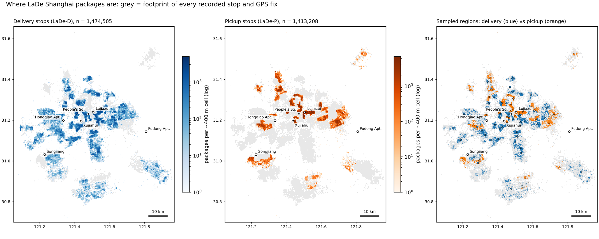
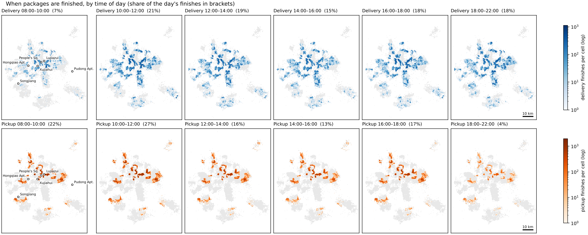
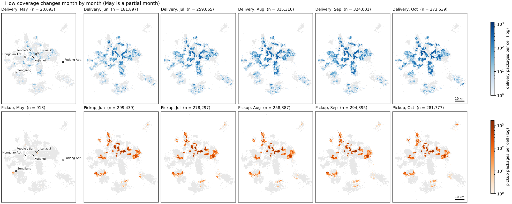
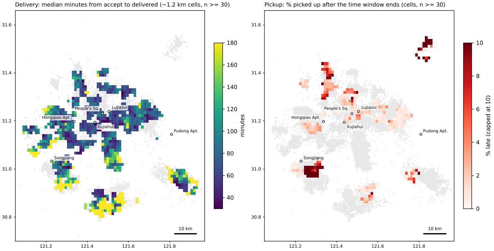
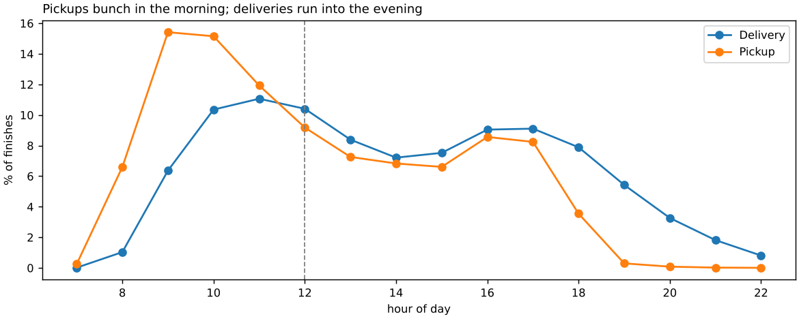
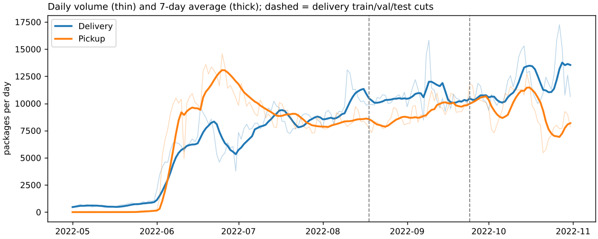

# LaDe Shanghai: Route + ETA Pipeline Design

Markdown copy of the design doc (live version: https://claude.ai/artifact/6hiVspCwm7XmA6fjLDCPH3), as of 2026-11-14.
The live doc has interactive charts; here they are static PNGs in `docs/figures/`.

## Overview

We build one graph neural network that predicts both the order in which a courier will serve their unfinished packages (route) and when each will be finished (ETA). It is scored against every baseline in the LaDe paper (arXiv 2306.10675 v3), using the paper's Shanghai results as targets.

- **Data:** LaDe Shanghai, pickup (LaDe-P) and delivery (LaDe-D). Both cleaned; 99.4% of delivery rows and 99.2% of pickup rows kept.
- **Where each score comes from:** the paper scores route on pickup and ETA on delivery. We train on both and report route on pickup and ETA on delivery, so every number lines up with a paper table. Route-on-delivery and ETA-on-pickup are extras.
- **What we compare against:** 9 route baselines and 7 ETA baselines. LightGBM must reproduce the paper's numbers before any new model is trusted (reproduction gate).

Pipeline: raw CSVs -> cleaning -> snapshot builder (features at time t, route + ETA labels) -> time split 6:2:2 by days -> benchmarks and our model (gate: LightGBM reproduces the paper first) -> evaluate (HR@3, KRC, LSD, ED / MAE, RMSE, ACC@20, ACC@30) -> test analyses (significance, segments, new couriers, robustness, leakage).

## Data

| | Delivery (LaDe-D) | Pickup (LaDe-P) |
| --- | --- | --- |
| File | delivery_sh.csv | pickup_sh.csv |
| Raw rows | 1,483,864 | 1,424,406 |
| Couriers | 1,733 | 4,494 |
| Regions / AOIs | 52 / 15,564 | 30 / 5,867 |
| Days with data | 184 (May 1 - Oct 31) | 177 (in practice from Jun 2) |
| Task list known at start of day? | Yes, fixed at the depot | No, requests arrive during the day |
| Time window | None | Start and end (median 2 h) |
| Missing GPS | None | 31% at finish, 46% at accept |

- **Year is 2022.** The paper says "a recent year"; the official LaDe GitHub README gives 2022-05-01 to 2022-10-31, so day of week is usable.
- **Coordinates are perturbed** to about 10 m for privacy. Stop coordinates come from Cainiao's geocoder, not GPS.
- **Couriers were sampled within regions** (paper Sec. 3.1), but the datasheet says each region holds all its packages. If only some couriers were sampled, region volumes undercount demand.
- **Only part of the city is covered** (randomly sampled regions; Figure 1).
- **Licence is CC BY-NC 4.0** (non-commercial), although the README header says Apache-2.0.
- **Validation:** after cleaning, average delivery accept-to-delivered time is 102.8 min vs the paper's 102 min (Table 12).

## Data cleaning

Removed 9,359 delivery rows (0.63%) and 11,198 pickup rows (0.79%). R-rules drop a row; G-rules only blank a bad GPS fix.

| Rule | What it catches | Why | Delivery | Pickup |
| --- | --- | --- | --- | --- |
| R1 | Duplicate order_id | Double counting | 0 | 0 |
| R2 | Unparseable time | No label | 0 | 0 |
| R3 | Stop outside Shanghai box (lng 120.85-122.20, lat 30.65-31.90) | Geocoding error | 37 | 0 |
| R4 | Finish date is not the record's day (ds) | Failed/held delivery finished days later | 6,174 | 0 |
| R5 | Finish before accept | Impossible | 0 | 0 |
| R6 | Finish in the same minute as accept | Closed in system; 0-min label is noise | 3,148 | 1,982 |
| R7 | Window end not after start | Invalid window | no windows | 0 |
| R8 | Window on a different day than the pickup | Rescheduled order | no windows | 9,216 |
| G1 | Finish GPS outside Shanghai or > 5 km from stop | Bad fix; would corrupt courier position | 20,126 blanked | 3,005 blanked |
| G2 | Accept GPS outside Shanghai | Same | 2 blanked | 284 blanked |
| | **Rows kept** | | **1,474,505** | **1,413,208** |

Kept on purpose: pickups accepted days earlier (4.3%, pre-booked; snapshots are within one day); same-day deliveries over 12 h (max 986 min); missing GPS stays missing with a flag. Pickups are 2.43% late, 24.96% early.

## Exploratory visualization

Map backgrounds are drawn from the data itself (grey = any recorded stop or GPS fix, ~400 m cells); landmarks are approximate. With LaDe's `roads.csv`, a real road network can replace this.

- **Spatial (Fig 1):** the two datasets barely overlap (1,458 of 15,564 delivery AOIs also appear in pickup). About 58% of packages lie within 15 km of People's Square.
- **Time of day (Fig 2, Fig 5):** 49% of pickups finish 08:00-12:00, almost none after 19:00; deliveries spread through the day (19.5% after 18:00).
- **By month (Fig 3, Fig 6):** delivery grows from 181,897 (June) to 373,539 (October); pickup flat at ~260-300k/month. Delivery test days (Sep 25 - Oct 31) average 11,839 packages, 32% more than training days Jul 1 - Aug 18 (8,954); pickup only 6% busier. Load must be a feature.
- **Service by place (Fig 4):** median delivery time 62 min within 10 km of People's Square, 73 at 10-20 km, 92 at 20-30 km, 113 beyond 30 km. Pickup lateness 2.0-2.5% inside 30 km, 6.3% beyond; region 53 (near Songjiang) 15.8% late, region 56 (far north-east) 32.3%.

## Sample construction

One sample = one moment in a courier's day: courier state + every package accepted but not finished. A snapshot is taken right after each finish event; at query time t a package is open if accept_time <= t < finish_time. Keep snapshots with 1-25 open packages (paper's limit).

| | Delivery | Pickup |
| --- | --- | --- |
| Query events (one per finish) | 1,404,440 | 1,318,695 |
| Kept: 1-25 open | 1,270,492 | 1,231,697 |
| Dropped: nothing open | 124,006 | 25,894 |
| Dropped: over 25 open | 9,942 (0.7%) | 61,104 (4.6%) |
| Median open per kept snapshot | 4 | 10 |
| Package rows across kept snapshots | 6.9M | 12.8M |
| Kept snapshots train / val / test | 539,145 / 347,993 / 383,354 | 654,151 / 296,771 / 280,775 |

Consecutive snapshots overlap heavily, so training can subsample; evaluation uses every test snapshot. A brute-force recount of random snapshots matches the builder exactly (tests/test_leakage.py).

**Labels:** route = open packages sorted by actual finish time (unique within courier-day, no ties); ETA = finish_time - t in minutes.

**Features (known at t):** node: position relative to courier, distance, AOI id/type, minutes since accepted, accept order, minutes to window start/end (pickup), same-AOI-as-last-stop. Edge: distance between stops, same AOI, window-end gap (road distance once roads.csv is added). Context: courier position (GPS of last finished stop, else its coordinates), hour, finished so far, number open, weekday, courier embedding, courier stats from training days only.

**Leakage rules** (automated checks): no field dated after t enters a feature; courier/AOI stats and scaling from training period only; a pickup accepted after t does not exist yet; weekday is allowed (year 2022).

**Split:** chronological 6:2:2 **by days** (decided 2026-11-14). Row-based cut is a robustness check.

| | Train | Validation | Test |
| --- | --- | --- | --- |
| Delivery | May 1 - Aug 18 (43.5% of rows) | Aug 19 - Sep 24 (26.8%) | Sep 25 - Oct 31 (29.7%) |
| Pickup | to Aug 22, in practice Jun 2 on (53.8%) | Aug 23 - Sep 26 (23.4%) | Sep 27 - Oct 31 (22.8%) |

Couriers unseen in training handle 27.3% of delivery and 24.0% of pickup test rows.

## Proposed model

1. **Graph:** packages + one courier node, fully connected (<= 25 packages); edges carry distance, same-AOI, window-end gap.
2. **Encoder:** 3 layers of edge-aware graph attention (GATv2-style), hidden {32, 64, 128}, residual + layer norm; AOI, AOI-type and courier embeddings.
3. **Route decoder:** pointer network with GRU state; soft time-window bias (25% of pickups are served before their window opens, so no hard mask).
4. **ETA head:** LSTM along the visiting order predicts positive increments; ETA = running sum (monotone). Teacher forcing in training; predicted order at test.
5. **Loss:** route cross-entropy + lambda * Huber(delta = 10 min); lambda in {0.1, 0.5, 1, 2}.

L = (1/n) sum_k -log p(pi_k | pi_<k, G_t) + lambda (1/n) sum_k Huber(yhat_pi_k - y_pi_k)

| Ablation | What changes | Question |
| --- | --- | --- |
| No graph | Attention without edge features (DeepRoute-like) | Does the explicit graph help? |
| No route conditioning | ETA straight from node vectors | Is joint route + ETA the source of gain? |
| No courier embedding | Courier stats only | Value of personal courier behaviour |
| Hard window mask | Pickup can't be chosen before its window opens | Is the soft bias right? |
| lambda = 0 / frozen route head | Single-task | Does each task help the other? |

The components recombine published ideas (Graph2Route, DeepRoute/FDNET pointer decoders, FDNET/RankETPA/M2G4RTP joint route+time). The research contribution is the new-courier direction below.

## Benchmarks (paper v3 Shanghai numbers)

Route, pickup (Table 3): higher HR@3/KRC better, lower LSD/ED better.

| Method | What it does | HR@3 | KRC | LSD | ED |
| --- | --- | --- | --- | --- | --- |
| TimeGreedy | Earliest deadline first | 59.81 | 39.93 | 5.20 | 2.24 |
| DistanceGreedy | Nearest stop next | 61.07 | 42.84 | 5.35 | 1.94 |
| OR-Tools | Shortest open path (windows for pickup) | 62.50 | 44.81 | 4.69 | 1.88 |
| LightGBM | Next-stop scorer applied greedily | 70.63 | 54.48 | 3.27 | 1.92 |
| FDNET | BiLSTM + pointer, also time | 69.05 | 52.72 | 4.08 | 1.86 |
| DeepRoute | Transformer + pointer | 71.66 | 56.20 | 3.26 | 1.86 |
| CPRoute | Not described in the paper; find source | 71.73 | 56.17 | 3.39 | 1.84 |
| Graph2Route | Dynamic graph encoder + personalized decoder | 71.69 | 56.53 | 3.12 | 1.86 |
| M2G4RTP | Graph model, route + time jointly | 71.73 | 56.34 | 3.16 | 1.86 |
| DRL4Route | Route model fine-tuned with RL | **72.18** | **57.20** | **3.06** | **1.84** |

ETA, delivery (Table 4): lower MAE/RMSE better, higher ACC@20 better.

| Method | What it does | MAE | RMSE | ACC@20 |
| --- | --- | --- | --- | --- |
| SPEED | Distance / courier speed | 26.68 | 31.31 | 52.57 |
| KNN | Mean of similar past samples | 25.22 | 29.57 | 65.71 |
| LightGBM | Boosted trees per package | 17.24 | 20.40 | 67.44 |
| FDNET | Joint route + time | 18.81 | 21.15 | 64.30 |
| MLP | 2-layer network | 16.16 | 19.31 | 72.17 |
| RankETPA | Route first, then times | 15.76 | 19.13 | 73.67 |
| M2G4RTP | Graph, route + time jointly | **8.23** | **9.59** | **91.01** |

The M2G4RTP ETA gap (8.23 vs 15.76) is far larger than any other step; re-run it on our setup before treating it as the bar.

## Training procedure

Same tuning budget, early stopping and 5 seeds for every deep model. Adam, grad-clip 1.0; lr 1e-4 (route/joint), 5e-5 (ETA-only); batch 64 (route/joint), 32 (ETA-only); hidden {16, 32, 64, 128}; up to 100 epochs, patience 5 (was 10; route converges within ~5 epochs, run 1), selecting on validation KRC for pickup and MAE for delivery (the scored task; the scaled sum let ETA noise pick epoch 1 in run 1, see `docs/experiment_log.md`); standardization fitted on train only; Huber loss, no label clipping. LightGBM: 31-255 leaves, lr 0.05, early stopping 100 rounds. Full set is ~2.5M snapshots / 19.7M package rows: start deep models on ~25% of training snapshots.

Order: snapshot builder + leakage checks -> rule baselines + LightGBM + reproduction gate -> deep baselines -> our model + ablations -> one final test per configuration.

## Evaluation metrics

Per snapshot, averaged over snapshots (route) or packages (ETA). HR@k = |Yhat_1:k ∩ Y_1:k| / k (k = 3); KRC = (Nc - Nd)/(Nc + Nd); LSD = mean |R_Y(i) - R_Yhat(i)|; ED = edit distance. MAE, RMSE, ACC@m = share with |error| < m minutes. Paper inconsistencies: LSD is named "square" but printed with absolute value; ACC@20 in main text, ACC@30 in appendix (report both). Report route metrics also for n <= 11 and 11 < n <= 25.

## Testing protocol

1. **Reproduction gate:** our LightGBM within ~5% of the paper (HR@3 70.63, MAE 17.24) before any deep model.
2. **Main test:** test period (late Sep - Oct), every method, mean ± std over 5 seeds.
3. **Is the gain real:** per-snapshot paired differences, 95% bootstrap CI over courier-days (10,000 resamples), Wilcoxon signed-rank.
4. **Segments:** n buckets; distance rings (<10, 10-20, 20-30, >30 km); hour; top-5 AOI types; seen vs new couriers; pickup high-lateness regions 53/56.
5. **Ablations** on the same test set and seeds.
6. **Robustness:** row-based 6:2:2 split; 10% courier hold-out.
7. **Leakage tests:** label shuffle -> chance; timestamp assertion; no test courier-day in training statistics.
8. **Later:** cross-city transfer (Hangzhou, Chongqing, Yantai, Jilin).

## Research direction: new couriers

Couriers absent from training handle 27.3% of delivery and 24.0% of pickup test rows; ID-based personalization has nothing for them.

1. **Courier-AOI graph** from training days only: courier-AOI edges (visit count, median service time), AOI-AOI spatial edges.
2. **Inductive embeddings** (GraphSAGE-style): courier profile aggregated from the AOIs they serve, no per-courier ID vector.
3. **Profile for a new courier at t:** from the AOIs of packages held today, updated with stops already finished today.
4. **Plug-in:** replaces the courier embedding in the proposed model.

Hypothesis: the seen-vs-new accuracy gap shrinks with little loss on seen couriers.

- [x] Go/no-go (2026-11-20): **modified go**. Courier knowledge matters for LightGBM, mainly for pickup ETA; the joint
  model ignores it. See "Courier-knowledge findings" below.
- [ ] Compare: no profile / ID embedding with fallback / courier-AOI graph.
- [ ] Hold out 10% of couriers; give 0, 1, 5, 20 days of history; plot learning curves.
- [ ] Report seen vs new in every results table.

## First results (preview, this workspace)

The pipeline runs end to end, but numbers do not match the paper yet, so sample/label/metric definitions differ from the official code. Day-based test split; GBDT rows used sklearn HistGradientBoosting in place of LightGBM on a subsample.

| Method | Data | Ours | Paper |
| --- | --- | --- | --- |
| TimeGreedy | Pickup route | HR@3 65.2, KRC 50.0, ED 6.6 | 59.81, 39.93, 2.24 |
| DistanceGreedy | Pickup route | HR@3 53.9, KRC 18.1, ED 8.0 | 61.07, 42.84, 1.94 |
| GBDT next-stop (20k train / 20k test snapshots) | Pickup route | HR@3 74.3, KRC 57.3, ED 5.9 | LightGBM 70.63, 54.48, 1.92 |
| SPEED | Delivery ETA | MAE 60.9, ACC@20 44.9% | 26.68, 52.57% |
| GBDT (150k train snapshots) | Delivery ETA | MAE 53.9, ACC@20 37.0% | LightGBM 17.24, 67.44% |

- ED ~2 in the paper vs 6-8 here: official metric code probably scores a route prefix or normalizes.
- ETA MAE 3-4x the paper's: our delivery ETA labels average 80 min (median 42); the paper's samples likely use shorter horizons or different query times.
- New couriers (GBDT route preview): HR@3 74.6 vs 74.3 seen; KRC 54.4 vs 58.2.

Official code: `route_prediction/` and `time_prediction/` in github.com/wenhaomin/LaDe.

## Reproduction in paper mode (2026-11-15)

Two evaluation settings from now on: **full-route** (ours, above; main setting for research claims) and
**paper mode** (port of the official LaDe sample construction and metrics; `src/lade/paper.py`, all differences
with line references in `docs/alignment_notes.md`). Key official choices: labels limited to (0, 120] min, route
label truncated at the courier's next accept, 24-row windows with at most 12 steps, test windows dropped when an
open task falls outside, at least 3 (pickup) / 2 (delivery) open tasks, LSD squared, ED and KRC on the truncated label.

| Method | Data | Paper mode | Paper |
| --- | --- | --- | --- |
| TimeGreedy | Pickup route | HR@3 59.81, KRC 40.01, LSD 5.21, ED 2.24 | 59.81, 39.93, 5.20, 2.24 |
| DistanceGreedy | Pickup route | HR@3 61.05, KRC 42.76, LSD 5.37, ED 1.94 | 61.07, 42.84, 5.35, 1.94 |
| LightGBM | Pickup route | HR@3 69.35, KRC 52.59, LSD 3.49, ED 1.96 | 70.63, 54.48, 3.27, 1.92 |
| SPEED | Delivery ETA | MAE 28.20, RMSE 33.28, ACC@20 51.6 | 26.68, 31.31, 52.57 |
| LightGBM | Delivery ETA | MAE 16.72, RMSE 19.73, ACC@20 69.9 | 17.24, 20.40, 67.44 |

**Reproduction gate passed.** Seen vs new couriers (LightGBM, paper mode): pickup KRC 55.4 vs 46.1, HR@3 70.3 vs
67.1; delivery MAE 16.5 vs 17.3 min. The route gap supports the new-courier direction.

## First joint-model run (2026-11-16, full-route, Colab T4)

Pickup, seed 0, 25% of training snapshots, selection on the combined score (later changed). Details: `docs/experiment_log.md`.

| Method | Pickup route (test) | Pickup ETA (test) |
| --- | --- | --- |
| TimeGreedy / SPEED | HR@3 65.2, KRC 50.0, ED 6.6 | MAE 111.6 |
| GBDT preview | HR@3 74.3, KRC 57.3, ED 5.9 | – |
| Joint model (run 1) | HR@3 74.3, KRC 58.5, ED 5.8 | MAE 64.1, ACC@20 35.7 |

Route converges in 3–5 epochs. The apparent ETA overfitting turned out to be a bug: new couriers' `c_known` was scaled to −10⁶.

**Current results (run 3, 2026-11-19, 5 seeds, fixed code, per-task selection, patience 5):**

| Joint model, test | HR@3 | KRC | ED | ETA MAE | ACC@20 |
| --- | --- | --- | --- | --- | --- |
| Pickup | 75.27 ± 0.05 | 60.01 ± 0.08 | 5.67 ± 0.01 | 38.13 ± 0.91 | 45.08 ± 0.81 |
| Delivery | 78.90 ± 0.11 | 46.96 ± 0.42 | 3.30 ± 0.02 | 51.66 ± 0.51 | 51.81 ± 0.35 |

It beats every rule baseline and the GBDT preview, except delivery ETA RMSE (101 vs 90). Seen vs new gaps are
confounded by snapshot differences (rule baselines show the same pattern). Details in `docs/experiment_log.md`.

## LightGBM full-route baseline (2026-11-19)

Real LightGBM, seed 0, full test split = the same rows as the joint model. Route trained on the same 25% of training
snapshots as joint seed 0; ETA on all training days.

| Test | HR@3 | KRC | ETA MAE | RMSE | ACC@20 |
| --- | --- | --- | --- | --- | --- |
| Pickup, LightGBM | 74.37 | 57.50 | **37.60** | **53.77** | 37.41 |
| Pickup, joint | **75.27** | **60.01** | 38.13 | 59.85 | **45.08** |
| Delivery, LightGBM | 78.01 | 41.77 | 53.18 | **89.16** | 37.08 |
| Delivery, joint | **78.90** | **46.96** | **51.66** | 101.17 | **51.81** |

Route: the joint model wins clearly. ETA: mixed. The joint model is better on MAE and ACC@20 (Huber loss), and
LightGBM on RMSE (L2 loss). On real new couriers the joint model degrades much less (pickup ETA 42.6 vs 49.4).

## Courier-knowledge findings (2026-11-19/20)

**Hidden-courier evaluation:** score seen-courier test rows twice, on the same rows with the same model: with the
courier's own input, and with the input a real new courier gets (id 0, c_known 0, fallback statistics). The
difference is the value of knowing the courier, free of the confound that new couriers handle different snapshots.

| Seen couriers, hidden − known | Pickup KRC | Pickup ETA MAE | Delivery KRC | Delivery ETA MAE |
| --- | --- | --- | --- | --- |
| Joint model (5 seeds) | −0.01 | +0.32 | −0.12 | −0.78 |
| LightGBM | −1.41 | **+12.13** | −0.20 | +4.54 |

What we learned:
1. **Courier information is valuable, mainly for ETA.** With it, LightGBM beats the joint model on seen couriers'
   pickup ETA (34.25 vs 36.86 min). Route order depends little on the courier.
2. **It acts as a per-courier tempo.** Pickup: the time window sets the ETA (96% of gain) and the courier's median
   task duration shifts it (−15 min for the fastest fifth, +9 for the slowest). Delivery: ETA ≈ pace × queue
   position, and courier statistics carry ~37% of the gain.
3. **Tempo is stable over months.** Per courier, training-period median duration vs test-period median ETA has a
   Spearman correlation of 0.70 on delivery (402 couriers). The statistics are not stale.
4. **The joint model ignores it.** It is robust (hidden ≈ known), which is why it does well on new couriers, but it
   leaves the seen-courier gain on the table. Likely causes: courier dropout, and courier information enters only
   through one context node.
5. **The new-courier fallback is biased.** It is the unweighted median over couriers, dominated by small couriers
   (pickup: 1.43 tasks/day, median duration in the bottom fifth). Part of LightGBM's new-courier loss is this bias
   plus an input combination never seen in training, not lost information.

Revised direction (replaces the plain "GraphSAGE instead of the ID embedding" plan): the new-courier problem is
**estimating a courier's tempo without history**.
- [ ] Cheap checks on LightGBM ETA: package-weighted fallback; courier dropout in training.
- [ ] q-time-safe "pace so far today" features (finished stops before q) as an online tempo estimate for every courier.
- [ ] Make the joint model use courier information (statistics into the ETA head, less or scheduled dropout) while
      keeping new-courier robustness.
- [ ] Then: does a courier-AOI graph profile (inductive, training days only) recover more of the gap than pace-so-far?

## Risks and open questions

| Risk | Effect | What we do |
| --- | --- | --- |
| Our setup does not reproduce paper numbers | No valid comparison | Align with official data processing + metrics first |
| M2G4RTP's 8.23 MAE may reflect a different setup | Misleading ETA comparison | Re-run on our split; compare definitions |
| Delivery test days 32% busier than Jul - mid-Aug training days | Load shift | Load features; results by month |
| Couriers may be sampled | Region volumes undercount demand | State as limitation |
| Coordinates perturbed ~10 m; geocoded stops | Short distances noisy | >= 400 m cells; prefer road distance |
| Delivery has 52 regions vs paper's 30 per city | Possible sample mismatch | Check against official loader |
| Snapshots over 25 packages dropped (0.7% / 4.6%) | Busiest moments missing | Report count; optional separate eval |
| Licence non-commercial | No commercial use | Research only |
